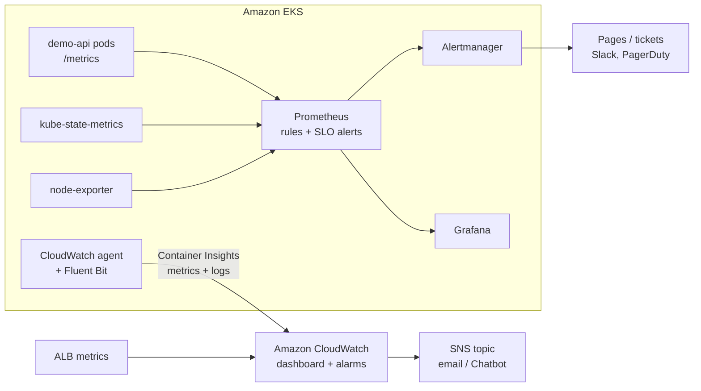

# Infrastructure Monitoring and Observability for Amazon EKS

Infrastructure and application monitoring using **Prometheus**, **Grafana**
and **Amazon CloudWatch**: visibility into resource utilisation, service
health, application latency and incident indicators, with SLO-based alerting
that is unit-tested in CI.

**Technologies:** Prometheus · Grafana · Alertmanager · Amazon CloudWatch (Container Insights, alarms, dashboards) · Kubernetes · Terraform · Observability

> **About this repository.** An independent reference implementation written
> to demonstrate observability practices for workloads on EKS. It monitors a
> synthetic sample application and contains no client code or data. It is
> designed for the cluster created by the companion **aws-eks-platform** repo,
> and the whole Prometheus/Grafana stack also runs locally with Docker Compose.

---

## Architecture



## What is monitored

| Signal | Metric source | Visualised in | Alerted by |
|---|---|---|---|
| Request rate, errors, latency (RED) | App `/metrics` | Grafana *Service Overview* | Burn-rate + latency alerts |
| SLO / error budget | Recording rules | Grafana stat panels | Fast/slow burn alerts |
| Service health | `up`, kube-state-metrics | Grafana, CloudWatch | Unavailable, restarts, replicas |
| Node CPU / memory / disk / network | node-exporter, Container Insights | Grafana *Node Resources*, CloudWatch | Prometheus + CloudWatch alarms |
| Load balancer 5xx and latency | ALB → CloudWatch | CloudWatch dashboard | CloudWatch alarms |
| Container logs | Fluent Bit | CloudWatch Logs | – |

See [docs/slo.md](docs/slo.md) for the SLO and why burn-rate alerting is used.

## Try it locally (no AWS needed)

Requires Docker.

```bash
make up            # app + load generator + Prometheus + Alertmanager + Grafana
```

| | URL |
|---|---|
| Grafana | http://localhost:3000 (admin / admin) → *Demo Platform* folder |
| Prometheus | http://localhost:9090/alerts |
| Alertmanager | http://localhost:9093 |

**Trigger an incident:**

```bash
make alerts-demo   # 20% of requests fail
make logs          # watch notifications arrive (~3-5 minutes)
make calm          # back to normal; alerts resolve
make down
```

## Deploy to EKS

```bash
# 1. Prometheus, Grafana, Alertmanager + this repo's rules and dashboards
./scripts/install-k8s.sh

# 2. CloudWatch Container Insights, alarms, SNS topic and dashboard
cd cloudwatch
cp terraform.tfvars.example terraform.tfvars   # set alert_email
terraform init && terraform apply
```

After the app's Ingress has created the ALB, set `alb_arn_suffix` in
`terraform.tfvars` and apply again to add the load balancer alarms.

> Before publishing, replace `Lifeofdrew2` in `prometheus/rules/*.yml`
> with your GitHub username so the alert runbook links work, then run `make render`.

## Repository layout

```
├── app/                       Sample service exposing Prometheus metrics
├── prometheus/
│   ├── rules/                 Recording rules + app, Kubernetes and node alerts
│   ├── tests/                 promtool unit tests for the alerts
│   └── prometheus.yml         Scrape config for the local stack
├── alertmanager/              Routing: critical → pages, warning → tickets
├── grafana/                   Dashboards (JSON) + provisioning
├── kubernetes/
│   ├── kube-prometheus-stack-values.yaml
│   ├── servicemonitor.yaml
│   └── generated/             PrometheusRule + dashboard ConfigMaps (from scripts/render_k8s.py)
├── cloudwatch/                Terraform: Container Insights add-on, alarms, SNS, dashboard
├── local/                     Docker Compose stack + load generator
├── scripts/                   render_k8s.py, install-k8s.sh
└── docs/                      SLO, runbooks, validation results
```

Rules and dashboards have **one source of truth**: the same files feed the
local stack and, via `scripts/render_k8s.py`, the cluster. CI fails if the
generated Kubernetes objects drift from their sources.

## Documentation

- [SLO and alerting approach](docs/slo.md)
- [Runbooks](docs/runbooks.md) – one section per alert
- [Validation results](docs/validation.md)
